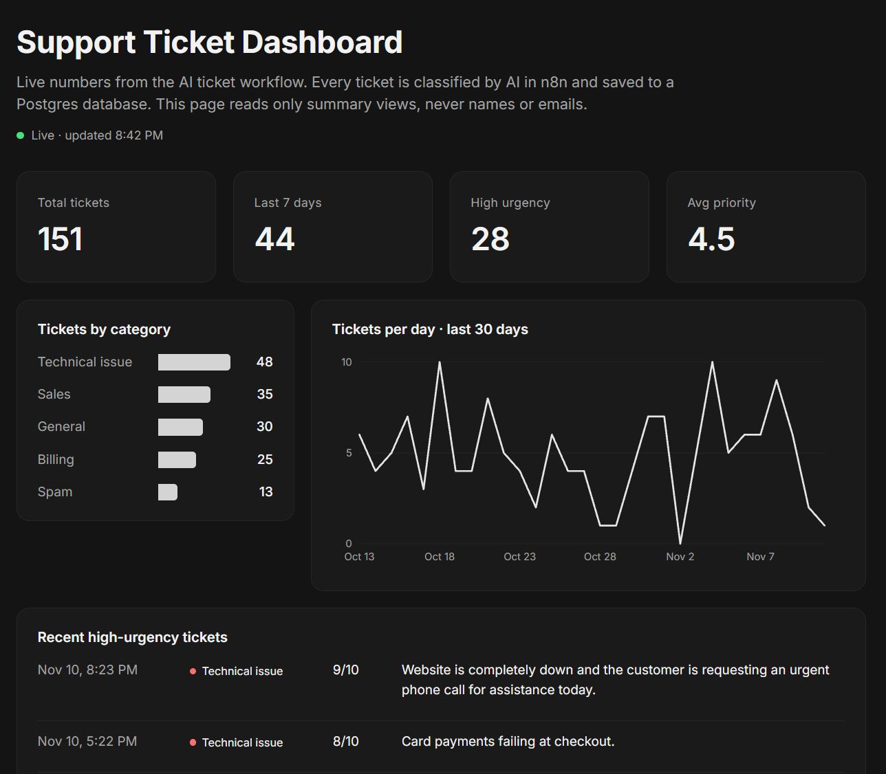
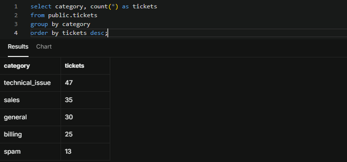
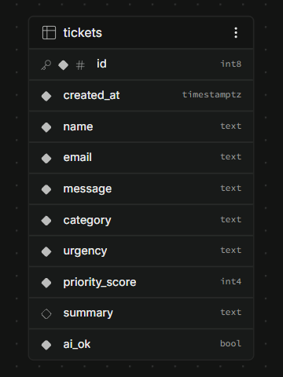
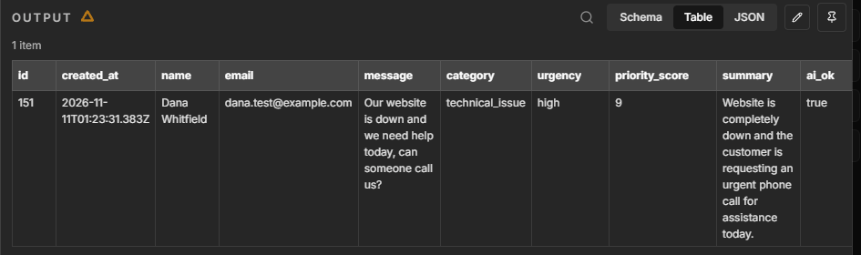

# Support Ticket Dashboard

Every support ticket from my [AI Support Ticket Triage](https://github.com/jacobjohnson-ai/ai-ticket-triage-n8n) workflow is saved to a Postgres database, and a live dashboard shows the trends: how many tickets came in, what they were about, and which ones were urgent.

**Live dashboard:** [jacobjohnson-ai.github.io](https://jacobjohnson-ai.github.io/#projects) (open "Support Ticket Dashboard")

## The problem

The triage workflow sorts each ticket as it arrives, but a support team also needs the bigger picture. Are tickets going up? Which category is growing? How many urgent issues came in this week? That needs the tickets stored in one place and summarized.

## How it works

1. A ticket comes in through the n8n workflow, and AI classifies it (category, urgency, priority score, summary).
2. n8n saves the ticket as a row in a Postgres table on Supabase.
3. Four SQL views summarize the table: headline numbers, tickets per category, tickets per day, and recent urgent tickets.
4. The dashboard page reads only those four views and draws the numbers and charts.

| Tool | Used for |
|---|---|
| n8n | Saves each classified ticket to the database (Postgres node) |
| Supabase (Postgres) | Stores the tickets, runs the SQL views |
| SQL | Table design, sample data, summary views |
| HTML, CSS, JavaScript | The dashboard and its charts (no chart library) |
| GitHub Actions | A daily check that keeps the free database from pausing |

## The SQL

| File | What it does |
|---|---|
| [`01_create_table.sql`](sql/01_create_table.sql) | Creates the `tickets` table with checks on category, urgency, and score, and turns on Row Level Security |
| [`02_sample_tickets.sql`](sql/02_sample_tickets.sql) | Adds 150 test tickets spread over 30 days so the charts have history |
| [`03_dashboard_views.sql`](sql/03_dashboard_views.sql) | Creates the four summary views and lets the public dashboard read only those |

Example: tickets per category, using `GROUP BY` and `COUNT`.

## Security

- **The tickets table is locked.** Row Level Security is on and there are no public policies, so names, emails, and messages can't be read from the outside.
- **The dashboard reads only summaries.** The public key can read the four views and nothing else. The urgent list shows the category, score, and AI summary, never who sent it.
- **The database checks its own data.** Category, urgency, and score have `CHECK` rules, so a bad value is rejected even if it gets past the workflow's validation.
- **The connection is verified.** n8n connects over SSL with the database's CA certificate installed, instead of turning certificate checks off.
- **The database password stays in n8n's credential store.** The key in the dashboard is Supabase's publishable key, which is meant to be public and is limited by the rules above.

## Run it yourself

1. Create a free project on [Supabase](https://supabase.com).
2. In the SQL Editor, run the three files in `sql/` in order.
3. In n8n, add a **Postgres → Insert rows** step after the "Parse AI result" step of the [triage workflow](https://github.com/jacobjohnson-ai/ai-ticket-triage-n8n). Use the Session pooler connection details, table `tickets`, and "Map Automatically."
4. In `dashboard/index.html`, replace the project URL and publishable key with your own, then open the page.

The tickets are sample data with fake names and `@example.com` emails, plus real test runs of the workflow.
